<div align="center">
  
</div>

<p align="center">
  <a href="https://github.com/redel-byte/CardProfiler">Explore an ML project</a>
  &nbsp;·&nbsp;
  <a href="https://github.com/redel-byte/EduPredict">See a prediction app</a>
  &nbsp;·&nbsp;
  <a href="mailto:ridouanelhabib1@gmail.com">Get in touch</a>
</p>

### Hey, I'm Elhabib 👋

I'm an **AI development student at YouCode** and a **full-stack web developer** based in Morocco. I like working across the whole path from raw data and model experiments to an interface someone can actually use.

```text
data  →  explore  →  model  →  evaluate  →  build an app
```

I have also built React and Node.js features for an accounting management application during a full-stack internship.

### Selected work

| Project | What I built | Stack |
| --- | --- | --- |
| [CardProfiler](https://github.com/redel-byte/CardProfiler) | Customer segmentation workflow comparing K-means and DBSCAN, with PCA, evaluation, and visual analysis. | Python · pandas · scikit-learn · Streamlit |
| [EduPredict](https://github.com/redel-byte/EduPredict) | Exam-score regression workflow with preprocessing, model evaluation, and a Streamlit prediction interface. | Python · scikit-learn · Streamlit |

### What I work with

**AI & data** `Python` `pandas` `NumPy` `scikit-learn` `PyTorch` `Streamlit`<br/>
**Web** `React` `JavaScript` `Node.js` `Express` `Laravel`<br/>
**Data & delivery** `PostgreSQL` `MongoDB` `Docker` `GitHub Actions` `MLflow`

I'm currently deepening my work with **LLM applications, RAG, and reliable model deployment**.

### Let's connect

[Email](mailto:ridouanelhabib1@gmail.com) · [LinkedIn](https://www.linkedin.com/in/el-habib-ridouane-ab64922a2/) · [GitHub projects](https://github.com/redel-byte?tab=repositories)

<sub>Built to stay readable in light and dark GitHub themes. The header animation pauses when reduced motion is preferred.</sub>
